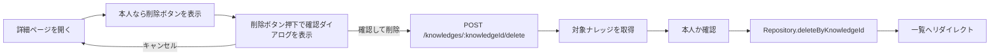

ナレッジ削除機能 実装 TODO
===============================================================================

目的
-------------------------------------------------------------------------------

主要機能要件の「ナレッジ削除 (Delete)」を実装する。

- 自分が投稿したナレッジだけを削除できる
- ページ遷移せず、確認ダイアログで誤削除を防げる
- 削除後にナレッジ一覧へ遷移できる
- 削除されたナレッジを一覧や詳細から取得できないようにする

既存実装の参考箇所
-------------------------------------------------------------------------------

- `src/models/knowledge.repository.ts`
    - `getByKnowledgeId()` は削除対象の取得に利用する
    - `deleteByKnowledgeId()` はまだ未実装
- `src/models/knowledge.model.ts`
    - 削除対象は `Knowledge` の `knowledgeId` と `authorId` を持つ
- `src/router.ts`
    - Hono のルート登録場所
    - `ctx.get('userId')` でログイン中ユーザーを取得できる
- `src/features/KnowledgeDetailFeature.tsx`
    - 詳細ページに本人専用の削除ボタンと確認ダイアログ付き削除フォームを配置する
- `src/features/Layout.tsx`
    - エラー画面などにも共通レイアウトを利用できる

推奨する URL
-------------------------------------------------------------------------------

```text
/knowledges/:knowledgeId/delete
```

例:

```text
/knowledges/305f56c6-260d-4b33-ae2e-c1f5bd4313ed/delete
```

推奨する HTTPメソッド
-------------------------------------------------------------------------------

- `POST /knowledges/:knowledgeId/delete`
    - 確認ダイアログでの承認後にナレッジを削除する

※ 確認は詳細ページ上のダイアログで行うため、削除確認画面用の `GET /knowledges/:knowledgeId/delete` は作成しない。

DELETEメソッドを利用する場合:

- `router.delete('/knowledges/:knowledgeId', ...)`
- フォームから送る場合は JavaScript または別途メソッド対応が必要

学習を優先するため、初期実装では HTML フォームから送信できる POST 方式を推奨する。

削除時の基本フロー
-------------------------------------------------------------------------------



Step 1: 詳細ページに本人専用の削除ボタンを配置する
-------------------------------------------------------------------------------

- [x] 詳細ページの Feature に現在のログインユーザー ID を渡せる構造にする
- [x] `knowledge.authorId === userId` の場合だけ削除ボタンを表示する
- [x] 他人には削除ボタンを表示しない
- [x] 削除ボタンは誤操作防止のため目立つ色を使う
- [x] フロント側の表示制御だけでなく、サーバー側の本人確認も必ず実装する

この Step の完遂条件:

- 投稿者本人だけに削除ボタンが表示される
- 他人には削除ボタンが表示されない

Step 2: 詳細ページに確認ダイアログと削除用 POST フォームを実装する
-------------------------------------------------------------------------------

- [x] `src/features/KnowledgeDetailFeature.tsx` の削除導線をページ遷移リンク (`<a>`) から削除用フォーム (`<form>`) へ変更する
- [x] フォームの送信先を `/knowledges/{knowledgeId}/delete`、HTTP メソッドを `POST` にする
- [x] 削除ボタン押下時にページ遷移せず、確認ダイアログを表示する
- [x] ユーザーへの確認（削除対象であること・削除は元に戻せない操作である旨）をダイアログメッセージ内で行う
- [x] ダイアログでキャンセルした場合は送信を中止し、詳細ページに留まる
- [x] ダイアログで承認した場合のみ `POST /knowledges/{knowledgeId}/delete` を送信する
- [x] 削除ボタンには「削除する」など明確な文言を使う

実装例（ブラウザ標準の確認ダイアログ `confirm()` を使うシンプルな方式）:

```tsx
<form
  action={`/knowledges/${knowledge.knowledgeId}/delete`}
  method="post"
  onsubmit="return confirm('このナレッジを削除しますか？\n削除したナレッジは元に戻せません。')"
>
  <button
    class="shrink-0 rounded-(--border-radius-8) bg-red-500 px-s py-2xs text-(length:--font-size-14) font-bold text-white hover:opacity-80"
    type="submit"
  >
    削除する
  </button>
</form>
```

※ デザインをカスタマイズしたい場合は、HTML 標準の `<dialog>` 要素を使ってダイアログ内に確認メッセージ・キャンセルボタン・削除実行フォームを配置する方式でも実装できる。

この Step の完遂条件:

- 削除ボタンを押してもページ遷移せず確認ダイアログが表示される
- ダイアログメッセージ内で削除確認と取り消し不可である旨を確認できる
- キャンセル時は削除が実行されず、承認時のみ削除用 POST が送信される

Step 3: 削除実行用の POST ルートを Router に追加する
-------------------------------------------------------------------------------

- [x] `src/router.ts` に `router.post('/knowledges/:knowledgeId/delete', ...)` を追加する
- [x] `ctx.req.param('knowledgeId')` で削除対象 ID を取得する
- [x] `ctx.get('userId')` でログイン中ユーザー ID を取得する
- [x] 削除処理用 Controller へ対象 ID とユーザー ID を渡す
- [x] 削除成功時は一覧 (`/`) へリダイレクトする
- [x] Controller へ Hono の Context を直接渡さない

ルート例:

```tsx
router.post('/knowledges/:knowledgeId/delete', async (ctx) => {
  const knowledgeId = ctx.req.param('knowledgeId');
  const userId = ctx.get('userId');

  await deleteKnowledgeController(knowledgeId, userId);

  return ctx.redirect('/');
});
```

この Step の完遂条件:

- 削除実行の POST リクエストを処理できる
- 削除成功後は一覧へリダイレクトする

Step 4: 削除処理用 Controller を作成する
-------------------------------------------------------------------------------

- [x] `src/controllers/delete-knowledge.controller.tsx` を作成する
- [x] `knowledgeId` と `userId` を引数として受け取る
- [x] 対象ナレッジを `KnowledgeRepository.getByKnowledgeId()` で取得する
- [x] 対象が存在しない場合は 404 相当として処理する
- [x] `knowledge.authorId === userId` をサーバー側で必ず確認する
- [x] 本人なら `KnowledgeRepository.deleteByKnowledgeId(knowledgeId)` を呼び出す
- [x] 削除成功時は一覧へ遷移することを Router へ伝える
- [x] 削除失敗時は例外を握りつぶさず呼び出し元へ伝える
- [x] HTTP ステータスの組み立ては Router に委譲する

確認ダイアログを経由せず URL へ直接 POST された場合でも、対象ナレッジの `authorId` とログイン中ユーザーをサーバー側で必ず比較する。

この Step の完遂条件:

- 本人だけがナレッジを削除できる
- 削除後に対象ナレッジを取得できない
- 削除失敗時に成功扱いしない

Step 5: Repository の deleteByKnowledgeId を実装する
-------------------------------------------------------------------------------

- [x] `src/models/knowledge.repository.ts` の `deleteByKnowledgeId()` を実装する
- [x] 対象の JSON ファイルパスを特定する
- [x] `node:fs/promises` の削除 API を利用する
- [x] 存在しないファイルの削除要求を適切に処理する
- [x] 削除失敗時は例外を呼び出し元へ伝える
- [x] 削除成功時に `void` または明確な成功値を返す

実装イメージ:

```ts
async function deleteByKnowledgeId(knowledgeId: string): Promise<void> {
  // knowledgeId に対応する JSON ファイルを削除する
}
```

保存形式に応じて実装を分ける。

- ファイル名が `<knowledgeId>.json` なら該当ファイルを削除する
- ディレクトリ形式ならディレクトリ内のファイルを削除する

注意:

- パスを文字列連結で作る場合は外部入力からのパス操作を避ける
- 削除前に `knowledgeId` とファイル内の `knowledgeId` が一致するか確認する
- Repository 以外の層ではファイルパスを直接扱わない

この Step の完遂条件:

- 対象ファイルだけが削除される
- 他のナレッジファイルは削除されない
- 削除後に `getAll()` から対象ナレッジが消える

Step 6: 削除失敗・権限外・存在しないナレッジを処理する
-------------------------------------------------------------------------------

- [x] 存在しないナレッジには 404 を返す
- [x] 投稿者ではないユーザーには 403 または拒否画面を返す
- [x] 権限なしの場合はファイルを削除しない
- [x] ファイル削除失敗時は 500 または再試行可能なエラー画面を返す
- [x] 削除成功時だけ一覧へリダイレクトする
- [x] エラー画面から一覧へ戻れる導線を作る

推奨するエラー優先順位:

1. 対象ナレッジが存在しない
2. 削除権限がない
3. ファイル削除に失敗

この Step の完遂条件:

- 不正な削除リクエストを保存状態へ反映しない
- ユーザーへ適切なエラー結果を返せる
- 成功時だけ一覧へリダイレクトする

Step 7: 削除処理のテストを追加する
-------------------------------------------------------------------------------

- [ ] 正しい ID と本人の組み合わせで削除できるテストを追加する
- [ ] 別ユーザーが削除できないテストを追加する
- [ ] 存在しない ID を削除できないテストを追加する
- [ ] 削除後に `getAll()` へ対象ナレッジが含まれないテストを追加する
- [ ] 削除後に `getByKnowledgeId()` へ対象ナレッジが返らないテストを追加する
- [ ] ファイル削除失敗時に例外を伝えるテストを追加する
- [ ] `knowledgeId` 以外のナレッジファイルを削除しないテストを追加する

モデルを追加する場合は既存ルールに従って対応する `.model.test.ts` を作成する。
テスト用保存先を分離できる場合は、本番の `storage/` へテストデータを残さない。

この Step の完遂条件:

- 本人確認が欠けてもテストで検出できる
- 対象ファイル以外が残ることを確認できる
- 削除後の一覧・詳細取得をテストできる

Step 8: 動作確認とビルドを実行する
-------------------------------------------------------------------------------

- [ ] `npm test` を実行する
- [ ] `npm run build` を実行する
- [ ] `npm start -- "テストユーザー"` を実行する
- [ ] 自分が作成したナレッジの詳細ページを開く
- [ ] 削除ボタンが表示されることを確認する
- [ ] 削除ボタンを押して確認ダイアログが表示されることを確認する
- [ ] ダイアログメッセージに削除確認と元に戻せない旨が表示されることを確認する
- [ ] ダイアログでキャンセルしたとき、削除されず詳細ページに留まることを確認する
- [ ] ダイアログで承認して削除を実行し、一覧へ戻ることを確認する
- [ ] 一覧から削除したナレッジが消えることを確認する
- [ ] 削除したナレッジの詳細 URL へアクセスして見つからないことを確認する
- [ ] サーバー再起動後もナレッジが復活しないことを確認する
- [ ] 別ユーザーで削除ボタンが表示されないことを確認する
- [ ] 別ユーザーで削除 URL へ直接 POST して拒否されることを確認する
- [ ] 存在しないナレッジの削除で 404 になることを確認する

受け入れ条件
-------------------------------------------------------------------------------

- [ ] 自分が投稿したナレッジだけに削除操作が表示される
- [ ] ページ遷移せず、確認ダイアログのメッセージ内で削除確認できる
- [ ] ダイアログでキャンセルした場合は削除されない
- [ ] 本人のみ削除できる
- [ ] 削除対象ファイルだけが削除される
- [ ] 削除成功後に一覧へ遷移する
- [ ] 削除後に一覧と詳細へ対象ナレッジが表示されない
- [ ] 存在しないナレッジと権限外の削除を拒否できる
- [ ] 削除失敗時に誤って成功扱いしない
- [ ] `npm test` と `npm run build` が成功する

推奨する実装順
-------------------------------------------------------------------------------

最初のスモールゴールは、本人だけに削除ボタンを表示し、詳細ページ上で確認ダイアログから `POST` できるようにすること。
次に削除対象を取得してサーバー側で本人確認を行うこと、次に `deleteByKnowledgeId()` でファイルを削除すること、最後に 404・403・削除失敗・テストを整える順で進める。

各 Step の完遂後に実行するコマンド:

```sh
npm test
npm run build
```
