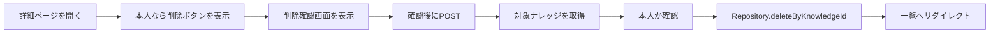

ナレッジ削除機能 実装 TODO
===============================================================================

目的
-------------------------------------------------------------------------------

主要機能要件の「ナレッジ削除 (Delete)」を実装する。

- 自分が投稿したナレッジだけを削除できる
- 誤削除を防ぐ確認手順を入れられる
- 削除後にナレッジ一覧へ遷移できる
- 削除されたナレッジを一覧や詳細から取得できないようにする

既存実装の参考箇所
-------------------------------------------------------------------------------

- `src/models/knowledge.repository.ts`
    - `getByKnowledgeId()` は削除対象の取得に利用する
    - `deleteByKnowledgeId()` はまだ未実装
- `src/models/knowledge.model.ts`
    - 削除対象は `Knowledge` の `knowledgeId` と `authorId` を持つ
- `src/router.ts`
    - Hono のルート登録場所
    - `ctx.get('userId')`でログイン中ユーザーを取得できる
- `src/features/Layout.tsx`
    - 確認画面にも共通レイアウトを利用できる
- 詳細表示機能
    - 詳細ページに削除ボタンまたは削除確認への導線を追加する
- 更新機能
    - 本人確認をGETとPOSTの両方で行う実装パターンを参考にする

推奨する URL
-------------------------------------------------------------------------------

```text
/knowledges/:knowledgeId/delete
```

例:

```text
/knowledges/305f56c6-260d-4b33-ae2e-c1f5bd4313ed/delete
```

推奨する HTTPメソッド
-------------------------------------------------------------------------------

- `GET /knowledges/:knowledgeId/delete`
    - 削除確認画面を表示する
- `POST /knowledges/:knowledgeId/delete`
    - 確認後にナレッジを削除する

DELETEメソッドを利用する場合:

- `router.delete('/knowledges/:knowledgeId', ...)`
- フォームから送る場合はJavaScriptまたは別途メソッド対応が必要

学習を優先するため、初期実装ではPOST方式を推奨する。

削除時の基本フロー
-------------------------------------------------------------------------------



Step 1: 詳細ページから削除確認への導線を作る
-------------------------------------------------------------------------------

- [ ] 詳細ページのFeatureに現在のログインユーザーIDを渡せる構造にする
- [ ] `knowledge.authorId === userId`の場合だけ削除ボタンを表示する
- [ ] 削除ボタンの遷移先は`/knowledges/{knowledgeId}/delete`を表示する
- [ ] 他人には削除ボタンを表示しない
- [ ] フロント側の表示制御だけでなく、サーバー側の本人確認も必ず実装する
- [ ] 削除ボタンは誤操作防止のため目立つ色と確認文を使う

この Step の完遂条件:

- 投稿者本人だけに削除ボタンが表示される
- 削除ボタンから確認画面へ遷移できる
- 他人には削除ボタンが表示されない

Step 2: 削除確認画面用の Feature を作成する
-------------------------------------------------------------------------------

- [ ] `src/features/KnowledgeDeleteFeature.tsx` を作成する
- [ ] Props に削除対象の `Knowledge` を受け取る
- [ ] `src/features/Layout.tsx` を利用して確認画面を構成する
- [ ] 削除対象のナレッジIDまたは本文の一部を表示する
- [ ] `/knowledges/{knowledgeId}/delete`へ `POST`するフォームを配置する
- [ ] 削除ボタンには「削除」など明確な文言を使う
- [ ] キャンセル時は詳細ページへ戻るリンクを表示する
- [ ] 削除は戻せない操作である旨をユーザーへ伝える

Propsの例:

```tsx
interface Props {
  knowledge: Knowledge;
}
```

この Step の完遂条件:

- 削除対象を確認できる
- 削除とキャンセルの選択肢がある
- 削除実行前に確認画面を経由できる

Step 3: GET と POST のルートを Router に追加する
-------------------------------------------------------------------------------

- [ ] `src/router.ts` に `router.get('/knowledges/:knowledgeId/delete', ...)`を追加する
- [ ] `ctx.req.param('knowledgeId')`で削除対象IDを取得する
- [ ] `ctx.get('userId')`でログイン中ユーザーIDを取得する
- [ ] 削除確認画面用Controllerへ対象IDとユーザーIDを渡す
- [ ] `router.post('/knowledges/:knowledgeId/delete', ...)`を追加する
- [ ] POST処理でも対象IDとユーザーIDを取得する
- [ ] 削除成功時は一覧へリダイレクトする
- [ ] ControllerへHonoのContextを直接渡さない

ルート例:

```tsx
router.get('/knowledges/:knowledgeId/delete', async (ctx) => {
  const knowledgeId = ctx.req.param('knowledgeId');
  const userId = ctx.get('userId');

  return ctx.html(await getKnowledgeDeleteController(knowledgeId, userId));
});

router.post('/knowledges/:knowledgeId/delete', async (ctx) => {
  const knowledgeId = ctx.req.param('knowledgeId');
  const userId = ctx.get('userId');

  await deleteKnowledgeController(knowledgeId, userId);

  return ctx.redirect('/');
});
```

この Step の完遂条件:

- 確認画面のGETリクエストを処理できる
- 削除実行のPOSTリクエストを処理できる
- 削除成功後は一覧へ遷移する

Step 4: 削除確認画面用 Controller を作成する
-------------------------------------------------------------------------------

- [ ] `src/controllers/get-knowledge-delete.controller.tsx`を作成する
- [ ] `knowledgeId`と`userId`を引数として受け取る
- [ ] `KnowledgeRepository.getByKnowledgeId(knowledgeId)`で対象を取得する
- [ ] 対象が存在しない場合は404相当の結果を返す
- [ ] `knowledge.authorId === userId`を確認する
- [ ] 他人のナレッジの場合は403または拒否画面を返す
- [ ] 本人なら`KnowledgeDeleteFeature`を返す
- [ ] HTTPステータスの組み立てはRouterに委譲する

処理の役割:

- 削除対象を取得する
- 削除権限を確認する
- 確認画面のFeatureへナレッジを渡す

この Step の完遂条件:

- 存在しないナレッジは確認画面へ表示しない
- 本人以外は確認画面へアクセスできない
- 本人だけが削除確認画面を開ける

Step 5: 削除処理用 Controller を作成する
-------------------------------------------------------------------------------

- [ ] `src/controllers/delete-knowledge.controller.tsx`を作成する
- [ ] `knowledgeId`と`userId`を引数として受け取る
- [ ] 対象ナレッジを`KnowledgeRepository.getByKnowledgeId()`で取得する
- [ ] 対象が存在しない場合は404相当として処理する
- [ ] `knowledge.authorId === userId`を再確認する
- [ ] 本人なら`KnowledgeRepository.deleteByKnowledgeId(knowledgeId)`を呼び出す
- [ ] 削除成功時は一覧へ遷移することをRouterへ伝える
- [ ] 削除失敗時は例外を握りつぶさず呼び出し元へ伝える

本人確認はGETだけでなくPOSTでも必ず行う。

確認画面を経由せずURLへ直接POSTした場合も、対象ナレッジのauthorIdと現在ユーザーを比較する必要がある。

この Step の完遂条件:

- 本人だけがナレッジを削除できる
- 削除後に対象ナレッジを取得できない
- 削除失敗時に成功扱いしない

Step 6: Repositoryの deleteByKnowledgeId を実装する
-------------------------------------------------------------------------------

- [ ] `src/models/knowledge.repository.ts`の`deleteByKnowledgeId()`を実装する
- [ ] 対象のJSONファイルパスを特定する
- [ ] `node:fs/promises`の削除APIを利用する
- [ ] 存在しないファイルの削除要求を適切に処理する
- [ ] 削除失敗時は例外を呼び出し元へ伝える
- [ ] 削除成功時に`void`または明確な成功値を返す

実装イメージ:

```ts
async function deleteByKnowledgeId(knowledgeId: string): Promise<void> {
  // knowledgeId に対応するJSONファイルを削除する
}
```

保存形式に応じて実装を分ける。

- ファイル名が `<knowledgeId>.json`なら該当ファイルを削除する
- ディレクトリ形式ならディレクトリ内のファイルを削除する

注意:

- パスを文字列連結で作る場合は外部入力からのパス操作を避ける
- 削除前に`knowledgeId`とファイル内の`knowledgeId`が一致するか確認する
- Repository以外の層ではファイルパスを直接扱わない

この Step の完遂条件:

- 対象ファイルだけが削除される
- 他のナレッジファイルは削除されない
- 削除後に`getAll()`から対象ナレッジが消える

Step 7: 削除失敗・権限外・存在しないナレッジを処理する
-------------------------------------------------------------------------------

- [ ] 存在しないナレッジには404を返す
- [ ] 投稿者ではないユーザーには403または拒否画面を返す
- [ ] 権限なしの場合はファイルを削除しない
- [ ] ファイル削除失敗時は500または再試行可能なエラー画面を返す
- [ ] 削除成功時だけ一覧へリダイレクトする
- [ ] エラー画面から一覧へ戻れる導線を作る

推奨するエラー優先順位:

1. 対象ナレッジが存在しない
2. 削除権限がない
3. ファイル削除に失敗

この Step の完遂条件:

- 不正な削除リクエストを保存状態へ反映しない
- ユーザーへ適切なエラー結果を返せる
- 成功時だけ一覧へリダイレクトする

Step 8: 削除処理のテストを追加する
-------------------------------------------------------------------------------

- [ ] 正しいIDと本人の組み合わせで削除できるテストを追加する
- [ ] 別ユーザーが削除できないテストを追加する
- [ ] 存在しないIDを削除できないテストを追加する
- [ ] 削除後に`getAll()`へ対象ナレッジが含まれないテストを追加する
- [ ] 削除後に`getByKnowledgeId()`へ対象ナレッジが返らないテストを追加する
- [ ] ファイル削除失敗時に例外を伝えるテストを追加する
- [ ] `knowledgeId`以外のナレッジファイルを削除しないテストを追加する

モデルを追加する場合は既存ルールに従って対応する`.model.test.ts`を作成する。
テスト用保存先を分離できる場合は、本番の`storage/`へテストデータを残さない。

この Step の完遂条件:

- 本人確認が欠けてもテストで検出できる
- 対象ファイル以外が残ることを確認できる
- 削除後の一覧・詳細取得をテストできる

Step 9: 動作確認とビルドを実行する
-------------------------------------------------------------------------------

- [ ] `npm test`を実行する
- [ ] `npm run build`を実行する
- [ ] `npm start -- "テストユーザー"`を実行する
- [ ] 自分が作成したナレッジの詳細ページを開く
- [ ] 削除ボタンまたは削除リンクが表示されることを確認する
- [ ] 削除確認画面を開く
- [ ] キャンセルして詳細ページへ戻れることを確認する
- [ ] 削除を実行して一覧へ戻る
- [ ] 一覧から削除したナレッジが消えることを確認する
- [ ] 削除したナレッジの詳細URLへアクセスして見つからないことを確認する
- [ ] サーバー再起動後もナレッジが復活しないことを確認する
- [ ] 別ユーザーで削除ボタンが表示されないことを確認する
- [ ] 別ユーザーで削除URLへ直接POSTして拒否されることを確認する
- [ ] 存在しないナレッジの削除で404になることを確認する

受け入れ条件
-------------------------------------------------------------------------------

- [ ] 自分が投稿したナレッジだけに削除操作が表示される
- [ ] 削除前に確認画面または確認動作を経由できる
- [ ] 本人のみ削除できる
- [ ] 削除対象ファイルだけが削除される
- [ ] 削除成功後に一覧へ遷移する
- [ ] 削除後に一覧と詳細へ対象ナレッジが表示されない
- [ ] 存在しないナレッジと権限外の削除を拒否できる
- [ ] 削除失敗時に誤って成功扱いしない
- [ ] `npm test` と `npm run build`が成功する

推奨する実装順
-------------------------------------------------------------------------------

最初のスモールゴールは、本人だけに削除確認画面への導線を表示すること。
次に削除対象を取得して本人確認を行うこと、次に`deleteByKnowledgeId()`でファイルを削除すること、最後に404・403・保存失敗・テストを整える順で進める。

各 Step の完遂後に実行するコマンド:

```sh
npm test
npm run build
```
