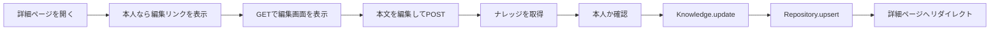

ナレッジ更新機能 実装 TODO
===============================================================================

目的
-------------------------------------------------------------------------------

主要機能要件の「ナレッジ更新 (Update)」を実装する。

- 自分が投稿したナレッジだけを編集できる
- 編集画面で現在の Markdown 本文を確認できる
- 更新後に詳細ページへ遷移できる
- 更新日時が更新処理後に変更される
- 作成日時やナレッジ ID は変更しない

既存実装の参考箇所
-------------------------------------------------------------------------------

- `src/models/knowledge.model.ts`
    - `Knowledge.update(knowledge, content)` がすでに実装済み
    - 作成日時を保持したまま、本文と更新日時を変更する
- `src/models/knowledge.repository.ts`
    - `getByKnowledgeId()` は更新対象の取得に利用する
    - `upsert()` は既存ナレッジの上書き保存に利用する
- `src/router.ts`
    - GET と POST のルート登録場所
    - `ctx.get('userId')` でログイン中ユーザーを取得できる
- `src/features/Layout.tsx`
    - 編集画面にも共通レイアウトを利用できる
- `src/models/knowledge.model.test.ts`
    - 更新処理の単体テストの参考になる
- 詳細表示機能
    - 詳細ページから編集画面へ遷移する導線を追加する

推奨する URL
-------------------------------------------------------------------------------

```text
/knowledges/:knowledgeId/edit
```

例:

```text
/knowledges/305f56c6-260d-4b33-ae2e-c1f5bd4313ed/edit
```

HTTPメソッドと役割
-------------------------------------------------------------------------------

- `GET /knowledges/:knowledgeId/edit`
    - 編集画面を表示する
- `POST /knowledges/:knowledgeId/edit`
    - 入力された本文でナレッジを更新する

更新時の基本フロー
-------------------------------------------------------------------------------



Step 1: 詳細ページから編集画面への導線を作る
-------------------------------------------------------------------------------

- [x] 詳細ページの Props または Feature に `Knowledge` を渡す
- [x] 詳細ページに現在のログインユーザー ID を渡せる構造にする
- [x] `knowledge.authorId === userId` の場合だけ編集リンクを表示する
- [x] 編集リンクは `/knowledges/{knowledgeId}/edit` を示す
- [x] 詳細ページを見た本人以外には編集リンクを表示しない
- [x] フロント側の表示制御だけでなく、後続Stepでサーバー側の本人確認も必ず行う

この Step の完遂条件:

- 投稿者本人だけに編集リンクが表示される
- 編集リンクから正しい ID の編集画面へ遷移できる
- 他人には編集リンクが表示されない

Step 2: 編集画面用の Feature を作成する
-------------------------------------------------------------------------------

- [x] `src/features/KnowledgeEditFeature.tsx` を作成する
- [x] Props に更新対象の `Knowledge` を受け取る
- [x] `src/features/Layout.tsx` を利用して編集画面を構成する
- [x] `<textarea name="content">` の初期値に既存の本文を設定する
- [x] フォームを `/knowledges/{knowledgeId}/edit`へ `POST` で送信する
- [x] キャンセル時は詳細ページへ戻れるリンクを配置する
- [x] 更新失敗時のエラーメッセージ表示領域を用意する
- [x] モバイルファーストの375pxレイアウトと既存のTailwindトークンを利用する

Props の例:

```tsx
interface Props {
  knowledge: Knowledge;
  error?: string;
}
```

この Step の完遂条件:

- 編集画面に現在の本文が表示される
- 本文を変更して送信できる
- 詳細ページへ戻れる

Step 3: GET と POST のルートを Router に追加する
-------------------------------------------------------------------------------

- [x] `src/router.ts` に `router.get('/knowledges/:knowledgeId/edit', ...)` を追加する
- [x] `ctx.req.param('knowledgeId')`で更新対象IDを取得する
- [x] `ctx.get('userId')`でログイン中ユーザーIDを取得する
- [x] 編集画面用 Controller にIDとユーザーIDを渡す
- [x] `router.post('/knowledges/:knowledgeId/edit', ...)` を追加する
- [x] `ctx.req.parseBody()` で新しい本文を取得する
- [x] POST処理でも対象IDとユーザーIDをControllerへ渡す
- [x] 更新成功時は詳細ページへリダイレクトする
- [x] Controller へ Hono の Context を直接渡さない

ルート例:

```tsx
router.get('/knowledges/:knowledgeId/edit', async (ctx) => {
  const knowledgeId = ctx.req.param('knowledgeId');
  const userId = ctx.get('userId');

  return ctx.html(await getKnowledgeEditController(knowledgeId, userId));
});
```

この Step の完遂条件:

- 編集画面のGETリクエストを処理できる
- 更新フォームのPOSTリクエストを処理できる
- 更新成功後は詳細ページへ遷移する

Step 4: 編集画面用 Controller を作成する
-------------------------------------------------------------------------------

- [x] `src/controllers/get-knowledge-edit.controller.tsx` を作成する
- [x] `knowledgeId` と `userId` を引数として受け取る
- [x] `KnowledgeRepository.getByKnowledgeId(knowledgeId)`で対象を取得する
- [x] 対象が存在しない場合は404相当の結果を返す
- [x] `knowledge.authorId === userId` を確認する
- [x] 他人のナレッジの場合は403または適切な拒否画面を返す
- [x] 投稿者本人なら `KnowledgeEditFeature` を返す
- [x] HTTPステータスの組み立てはRouterに委譲する

処理の役割:

- 対象ナレッジを取得する
- 更新権限があるか判定する
- 編集画面用のFeatureへナレッジを渡す

この Step の完遂条件:

- 存在しないナレッジは編集画面へ表示しない
- 本人以外は編集画面へアクセスできない
- 本人だけが現在の本文を編集できる

Step 5: POSTで本文を更新する Controller を作成する
-------------------------------------------------------------------------------

- [x] 更新処理用の Controller または同一Controllerの関数を作成する
- [x] `knowledgeId`、`userId`、新しい `content` を引数として受け取る
- [x] 対象ナレッジを`KnowledgeRepository.getByKnowledgeId()`で取得する
- [x] 対象が存在しない場合は404相当として処理する
- [x] `knowledge.authorId === userId` を再確認する
- [x] 本人かつ本文が有効なら `Knowledge.update(knowledge, content)` を呼び出す
- [x] 更新後のナレッジを `KnowledgeRepository.upsert(updatedKnowledge)`で保存する
- [x] 成功時は詳細ページへのリダイレクト情報を返す

重要:

本人確認はGETだけでなくPOSTでも必ず行う。
URLを直接叩いて更新するリクエストも同じ権限チェックを通す必要がある。

この Step の完遂条件:

- 本人だけが本文を更新できる
- 更新後のナレッジが保存される
- 保存されたナレッジのIDと作成者が変わらない

Step 6: 入力チェックを追加する
-------------------------------------------------------------------------------

- [x] 空文字または空白だけの本文を拒否する
- [x] エラー時は編集画面へ戻す
- [x] 入力済みの本文をエラー画面に再表示する
- [x] 正常な本文で更新できることを確認する
- [x] バリデーションはModelのドメインルールとして検討する

推奨する検証例:

```ts
if (content.trim() === '') {
  return { ok: false, error: '本文を入力してください' };
}
```

空本文ルールを `Knowledge.update()` 自体へ追加する場合:

```ts
function update(self: Knowledge, content: Knowledge['content']): Knowledge {
  if (content.trim() === '') {
    throw new Error('本文を入力してください');
  }

  return {
    ...self,
    content,
    updatedAt: Math.floor(Date.now() / 1000),
  };
}
```

この Step の完遂条件:

- 空本文を保存できない
- エラー時に本文とエラー理由をユーザーへ表示できる
- 正常な本文だけが保存される

Step 7: Repositoryのupsertを確認する
-------------------------------------------------------------------------------

更新機能では、新規作成と同じ `upsert()` を利用する。

- [x] `upsert()` が同じ `knowledgeId` のファイルを上書きできることを確認する
- [x] 別の `knowledgeId` のファイルを生成しないことを確認する
- [x] 保存失敗時に例外を呼び出し元へ伝える
- [x] 保存後に`KnowledgeRepository.getByKnowledgeId()`で更新後本文を取得できることを確認する
- [x] `getAll()`で一覧の更新済み内容へ影響することを確認する

この Step の完遂条件:

- 更新対象の既存ファイルだけが上書きされる
- 新しいナレッジが追加されない
- 保存失敗時に不正に更新成功扱いしない

Step 8: 権限・存在しないナレッジ・保存失敗を処理する
-------------------------------------------------------------------------------

- [x] 存在しないナレッジには404を返す
- [x] 投稿者ではないユーザーには403または拒否画面を返す
- [x] 本人確認失敗時に内容を更新しない
- [x] 保存失敗時に500または再入力画面を返す
- [x] エラーに見えても更新処理が完了していないことを確認する
- [x] 成功時だけ詳細ページへリダイレクトする

推奨するエラー優先順位:

1. 対象ナレッジが存在しない
2. 更新権限がない
3. 入力本文が空
4. ファイル保存に失敗

この Step の完遂条件:

- 不正な更新リクエストを保存しない
- ユーザーへ適切なエラー結果を返せる
- 成功時だけリダイレクトする

Step 9: 更新処理のテストを追加する
-------------------------------------------------------------------------------

- [x] `Knowledge.update()` が本文と更新日時を変更するテストを追加する
- [x] `knowledgeId` と `authorId` が変更されないテストを追加する
- [x] `createdAt` が変更されないテストを追加する
- [x] 空本文で更新できないテストを追加する
- [x] 本人以外の更新リクエストを拒否するテストを追加する
- [x] 存在しないナレッジを更新できないテストを追加する
- [x] 同じ `knowledgeId` のファイルだけが上書きされるテストを追加する

既存テストは [src/models/knowledge.model.test.ts](src/models/knowledge.model.test.ts) を参考にする。

この Step の完遂条件:

- 更新ドメインルールをテストで確認できる
- 本人確認が欠けてもテストで検出できる
- 作成時のフィールドが更新で壊れない

Step 10: 動作確認とビルドを実行する
-------------------------------------------------------------------------------

- [x] `npm test` を実行する
- [x] `npm run build` を実行する
- [x] `npm start -- "テストユーザー"` を実行する
- [x] 自分が作成したナレッジの詳細ページを開く
- [x] 編集リンクが表示されることを確認する
- [x] 編集画面に現在の本文が表示されることを確認する
- [x] 本文を変更して送信する
- [x] 詳細ページへ戻り、更新本文と更新日時が反映されることを確認する
- [x] サーバー再起動後も更新内容が残ることを確認する
- [x] 別ユーザーで詳細ページを開き、編集リンクがないことを確認する
- [x] 別ユーザーで編集URLへ直接アクセスして拒否されることを確認する
- [x] 空本文で更新できないことを確認する
- [x] 存在しないナレッジの編集URLで404になることを確認する

受け入れ条件
-------------------------------------------------------------------------------

- [x] 自分が投稿したナレッジだけに編集リンクが表示される
- [x] 編集画面に現在の本文を表示できる
- [x] 本人のみ更新できる
- [x] `Knowledge.update()`で本文と更新日時を更新できる
- [x] `knowledgeId` と `authorId` と `createdAt` は変更しない
- [x] 空本文は更新できない
- [x] 更新成功後に詳細ページへ遷移する
- [x] 存在しないナレッジと権限外の更新を拒否できる
- [x] `npm test` と `npm run build` が成功する

推奨する実装順
-------------------------------------------------------------------------------

最初のスモールゴールは、本人だけに編集リンクを表示すること。
次に現在本文を表示する編集画面を作ること、次にGETとPOSTの本人確認を追加すること、最後に `Knowledge.update()` と `upsert()` を組み合わせて保存・テストする順で進める。

各 Step の完遂後に実行するコマンド:

```sh
npm test
npm run build
``` 
